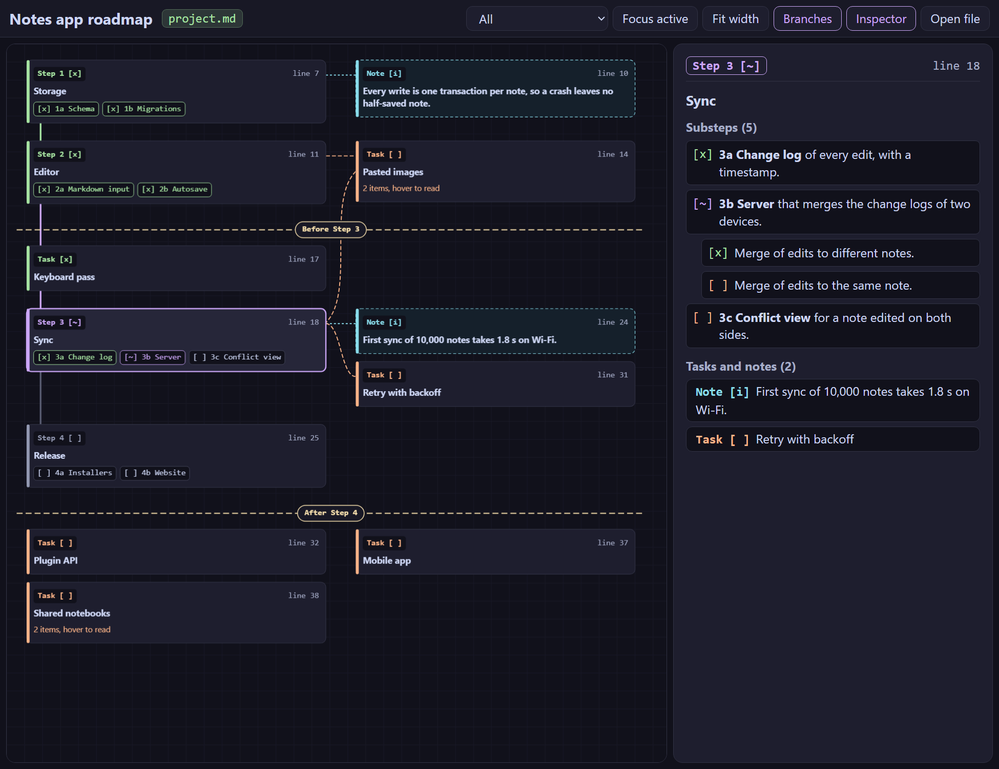
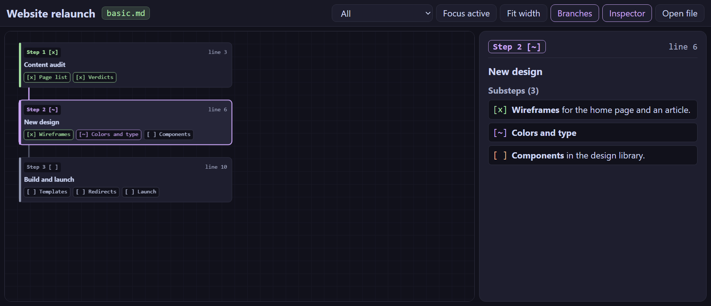

# md-roadmap

One HTML page that draws a roadmap from a markdown checklist.
The steps run down a spine, with their tasks and notes beside them.
Items due before or after a step sit in bands between the steps.



## Use

Open `roadmap.html` in a browser and drop a markdown file on it, or pick one with **Open file**.
The page needs no server and loads nothing from the network.

For a page that opens with the file already inside it:

```bash
python embed.py TODO.md
```

This writes `TODO.html` next to `TODO.md`, and `-o` picks another path.
Run it again after each edit of the markdown.

## Markers

A list item joins the graph through a marker in its text.

| Marker | Places the item |
|---|---|
| `[#step:KEY]` | on the spine, as a step |
| `[#task:KEY]` | beside step KEY, as a task |
| `[#note:KEY]` | beside step KEY, as a note |
| `[#task:KEY>OTHER]` | beside step KEY, with an arrow to step OTHER |
| `[#before:KEY]` | in a band right before step KEY |
| `[#after:KEY]` | in a band right after step KEY |

A key is made of letters, digits, `.`, `_` and `-`, and its case is ignored.
An item can sit anywhere in the file, so a task written in a backlog section still lands beside its step.
A task, note, before or after marker on a heading applies to every top-level item under it that has none.

## Text and state

- The checkbox sets the state, `[x]` done, `[~]` active and `[ ]` open. A note has no state.
- In `**Step 2 [#step:2]: Editor**` the text before the marker is the label and the text after it is the title. Without the colon the label is `Task`, `Note` or `Step KEY`.
- When an item starts in bold, the bold part is its title and the rest of the line shows on hover.
- A nested item with no marker belongs to the nearest marked item above it.
- Under a step, the first nested level becomes the pills on its box. Deeper levels show on hover and in the inspector.
- An item with no marker and no marked parent stays off the graph, and so does anything inside a code block.
- The first `#` heading is the title of the page.

## Controls

- The filter keeps all items, the open and active ones, or the done ones. Its last choice keeps the steps with tasks or notes, and the bands.
- **Focus active** scrolls to the first active item at 65 %, or to the first step left open. The page also opens this way.
- **Fit width** zooms out until both columns fit.
- **Branches** hides or shows the tasks and notes beside the steps.
- **Inspector** hides or shows the side panel with the full text of the selected box.
- **Open file** loads another markdown file, and so does a file dropped on the page.

Dragging moves the graph and the wheel zooms around the pointer.
A click selects a box, and hovering over one shows all of its text.

## Examples

Each example has its markdown, the page `embed.py` wrote for it, and a screenshot of that page.

### basic.md

```markdown
# Website relaunch

- [x] **Step 1 [#step:1]: Content audit**
  - [x] **Page list:** every page with its monthly visits.
  - [x] **Verdicts:** keep, merge or drop for each page.
- [~] **Step 2 [#step:2]: New design**
  - [x] **Wireframes** for the home page and an article.
  - [~] **Colors and type**
  - [ ] **Components** in the design library.
- [ ] **Step 3 [#step:3]: Build and launch**
  - [ ] **Templates** for the four page types.
  - [ ] **Redirects** from every old address.
  - [ ] **Launch**
```



### project.md

[examples/project.md](examples/project.md) uses every marker, and its page is the screenshot at the top.

- Line 14 puts a task beside Step 2 with an arrow to Step 3.
- Line 17 lands in the band before Step 3, and line 31 joins Step 3 from the backlog.
- The heading `## 3. Later [#after:4]` sends its two items to the band after Step 4.
- The line "Dark theme for the website" has no marker, so it stays off the graph.

## License

MIT, in `LICENSE`.
